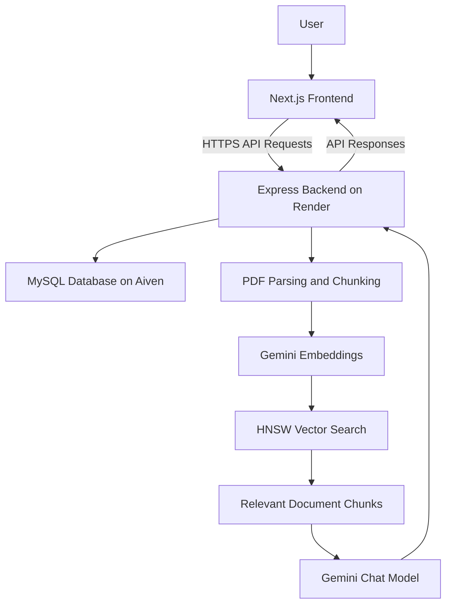

# ChatSensei 📄🤖

**ChatSensei** is a full-stack Retrieval-Augmented Generation (RAG) platform that allows users to chat with their PDF documents. Upload PDFs, ask questions in natural language, and get context-aware answers based on relevant document content.

<p align="center">
  <a href="https://chat-sensei-omega.vercel.app">
    
  </a>
  <a href="https://github.com/Saniya0804/ChatSensei">
    
  </a>
</p>

## 🌐 Live Deployment

| Component | Platform | URL |
|---|---|---|
| Frontend | Vercel | [ChatSensei Live Website](https://chat-sensei-omega.vercel.app) |
| Backend API | Render | [ChatSensei API](https://chatsensei-api.onrender.com) |
| Database | Aiven | Managed MySQL database |

Visit the live website to register an account, upload a PDF, and ask questions about its contents.

## ✨ Features

- **Document Q&A with RAG:** Ask questions about PDF documents and receive answers grounded in retrieved document content.
- **Multi-document support:** Query across multiple saved PDFs and supported temporary uploads.
- **Semantic search:** Generate embeddings using Google's Gemini embedding model and retrieve relevant document chunks with HNSW vector search.
- **Multi-session chat:** Create multiple chat sessions and retrieve previous conversations.
- **User authentication:** Register and log in with a username and password.
- **PDF management:** Upload, list, and delete PDF files.
- **Persistent storage:** Store users, PDF records, chat sessions, and messages in MySQL according to the configured database schema.
- **AI-powered responses:** Generate context-aware answers using Google's Gemini chat model.
- **Cloud deployment:** Host the frontend on Vercel, backend on Render, and database on Aiven.

## 🏗️ System Architecture



### How it works

1. Users register or log in through the frontend.
2. The backend processes requests and interacts with the MySQL database.
3. Uploaded PDFs are parsed into text and split into smaller chunks.
4. Gemini generates vector embeddings for the document chunks.
5. HNSW retrieves the most relevant chunks for a question.
6. The retrieved context is passed to Gemini to generate an answer.
7. Questions and answers are stored in MySQL and associated with chat sessions.

**Note:** The current architecture uses an in-memory HNSW index. Unless vector-index persistence is implemented separately, the index may need to be rebuilt after a backend restart. This is separate from MySQL persistence.

## 🧰 Tech Stack

### Frontend
- Next.js 16 — App Router
- React 19
- TypeScript
- Tailwind CSS 4

### Backend
- Node.js
- Express 5
- MySQL2
- Multer for file uploads

### AI and Retrieval
- LangChain
- `@langchain/community`
- `@langchain/core`
- `@langchain/classic`
- `@langchain/google-genai`
- Google Gemini `gemini-embedding-001`
- Google Gemini `gemini-2.5-flash`
- `hnswlib-node`
- `pdf-parse` and/or LangChain `PDFLoader`

### Database and Deployment
- Aiven for MySQL
- Render
- Vercel
- Git and GitHub

## 📁 Project Structure

```text
ChatSensei/
├── client/
│   └── app/
│       ├── page.tsx
│       ├── login/
│       ├── register/
│       └── dashboard/
│
└── server/
    ├── controllers/
    ├── routes/
    ├── database.js
    └── server.js
```

- `client/` — Next.js frontend.
- `client/app/` — Landing page, login, registration, and dashboard.
- `server/controllers/` — API request-handling logic.
- `server/routes/` — Backend API routes.
- `server/database.js` — MySQL database configuration and table definitions.
- `server/server.js` — Express application entry point.

## 🔌 API Endpoints

| Method | Endpoint | Description |
|---|---|---|
| `POST` | `/register/users` | Register a new user |
| `POST` | `/login/users` | Log in a user |
| `POST` | `/upload/files` | Upload a PDF |
| `GET` | `/upload/files/:id` | Retrieve a user's uploaded files |
| `DELETE` | `/upload/deleteFiles/:id` | Delete an uploaded PDF |
| `POST` | `/chat/session` | Create a chat session |
| `POST` | `/chat/ask/:id` | Ask a question using document retrieval |
| `GET` | `/chat/session/:userid` | Retrieve a user's chat sessions |
| `GET` | `/chat/messages/:sessionId` | Retrieve messages for a session |

The exact request bodies, authorization requirements, and response formats depend on the backend implementation.

## 🚀 Getting Started

### Prerequisites

- Node.js 18 or later
- npm
- A MySQL database
- A Google Gemini API key

### 1. Clone the repository

```bash
git clone https://github.com/Saniya0804/ChatSensei.git
cd ChatSensei
```

### 2. Configure the backend

```bash
cd server
npm install
```

Create a `.env` file inside the `server/` directory:

```env
PORT=8000

# Google Gemini API
GOOGLE_API_KEY=your_gemini_api_key

# Aiven MySQL Database
DB_HOST=your_mysql_host
DB_USER=your_mysql_username
DB_PASSWORD=your_mysql_password
DB_NAME=your_database_name
DB_PORT=your_mysql_port
DB_SSL=true

# Authentication
JWT_SECRET=your_strong_random_secret
JWT_EXPIRES_IN=7d

# Frontend
FRONTEND_URL=http://localhost:3000
```

Replace the placeholder values with your own credentials. Ensure the backend code reads these variables from `process.env` and configures the MySQL SSL connection correctly.

Start the backend using the script defined in `package.json`:

```bash
npm run dev
```

If configured for port 8000, the backend runs at:

`http://localhost:8000`

### 3. Configure the frontend

Open a new terminal:

```bash
cd client
npm install
```

Configure the frontend API URL using the environment variable name expected by your code. For example, if the application uses `NEXT_PUBLIC_API_URL`, create `client/.env.local`:

```env
NEXT_PUBLIC_API_URL=http://localhost:8000
```

Make sure the frontend actually references this variable. If your code uses a different variable name, configure that instead.

Start the frontend:

```bash
npm run dev
```

Open [http://localhost:3000](http://localhost:3000).

## ☁️ Production Deployment

### Frontend — Vercel

The Next.js frontend is deployed on Vercel.

**Live URL:** [https://chat-sensei-omega.vercel.app](https://chat-sensei-omega.vercel.app)

Configure the production API URL in Vercel to point to the deployed Render backend, using the environment variable name expected by the frontend code.

### Backend — Render

The Express backend is deployed on Render.

**Backend URL:** [https://chatsensei-api.onrender.com](https://chatsensei-api.onrender.com)

Configure these environment variables in the Render dashboard:

- `PORT`
- `GOOGLE_API_KEY`
- `DB_HOST`
- `DB_USER`
- `DB_PASSWORD`
- `DB_NAME`
- `DB_PORT`
- `DB_SSL`
- `JWT_SECRET`
- `JWT_EXPIRES_IN`
- `FRONTEND_URL`

Set the production frontend origin to:

```env
FRONTEND_URL=https://chat-sensei-omega.vercel.app
```

Ensure the backend CORS configuration allows this origin.

### Database — Aiven for MySQL

ChatSensei uses a managed MySQL database hosted on Aiven.

Configure the Aiven connection details through the backend environment variables. Ensure the required database and tables exist and that the backend connects using the appropriate SSL settings.

Never publish database credentials in source code or GitHub.

## 🧠 RAG Pipeline

1. **Document loading:** Load saved PDFs and supported temporary uploads.
2. **Text extraction:** Parse the PDF content.
3. **Chunking:** Split text into approximately 1,000-character chunks with 200-character overlap, depending on the configured splitter.
4. **Embedding generation:** Generate embeddings with `gemini-embedding-001`.
5. **Vector indexing:** Index the embeddings using HNSW.
6. **Semantic retrieval:** Retrieve relevant chunks for the user's question.
7. **Answer generation:** Pass retrieved context to `gemini-2.5-flash` through the LangChain retrieval pipeline.
8. **Conversation storage:** Save questions and answers in MySQL, associated with the relevant chat session.

RAG helps ground responses in document content but does not guarantee that every generated answer will be correct.

## 🔒 Security and Reliability

- Store API keys and passwords in environment variables or your hosting provider's secret manager.
- Never commit `.env` files or production secrets to GitHub.
- Store passwords as secure hashes using a suitable password-hashing algorithm.
- Use a strong, randomly generated JWT secret.
- Validate uploaded file types
